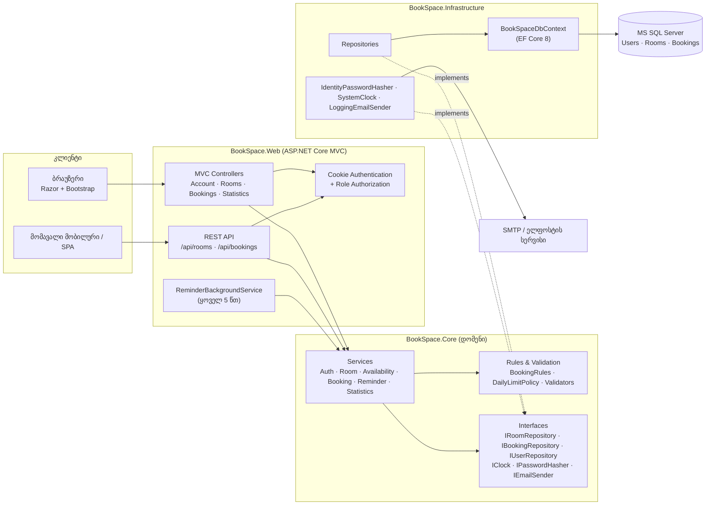
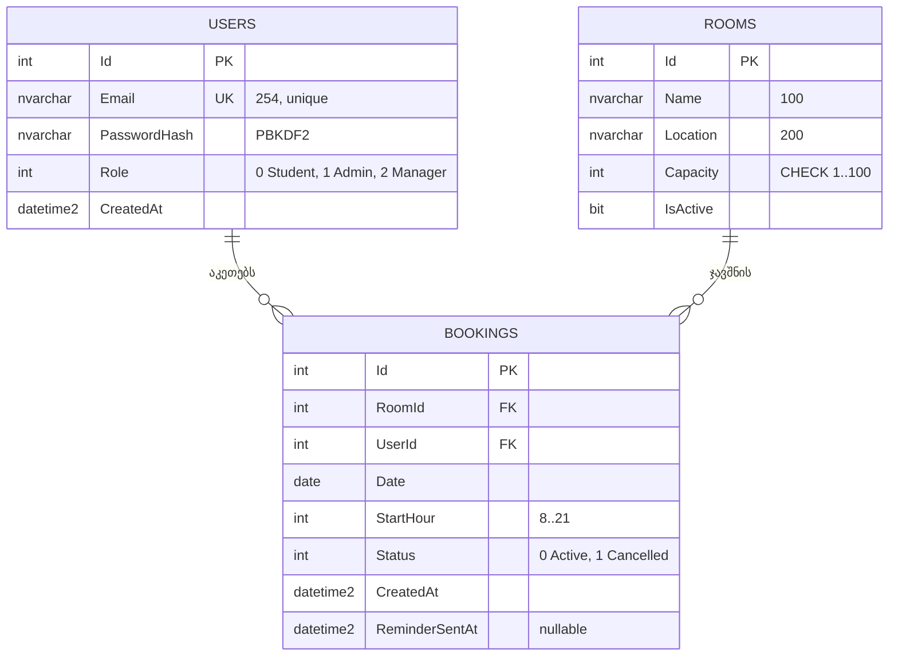

# BookSpace — არქიტექტურა (პრაქტიკული 2)

> სცენარი: **D. საკუთარი იდეა** — სასწავლო ოთახების დაჯავშნის ვებპლატფორმა უნივერსიტეტისთვის.

## 1. არქიტექტურული სტილი: ფენოვანი მონოლითი (Layered / Clean Monolith)

სისტემა არის **ერთი ASP.NET Core MVC აპლიკაცია**, რომელიც შიგნით სამ ფენად (პროექტად) არის დაყოფილი:

| ფენა | პროექტი | პასუხისმგებლობა |
|---|---|---|
| Presentation | `BookSpace.Web` | MVC კონტროლერები, Razor Views, REST API, ავტორიზაცია (cookie) |
| Domain / Application | `BookSpace.Core` | ენტიტები, ბიზნეს-წესები, სერვისები, ინტერფეისები. **არცერთ ფრეიმვორკზე არ არის დამოკიდებული** |
| Infrastructure | `BookSpace.Infrastructure` | EF Core + MS SQL Server, რეპოზიტორიები, ჰეშერი, ელფოსტა, საათი |

დამოკიდებულების მიმართულება: `Web → Core ← Infrastructure` (Dependency Inversion — Core განსაზღვრავს ინტერფეისებს, Infrastructure ახორციელებს).

**არგუმენტები:**

1. **მასშტაბი და გუნდი.** 1 დეველოპერი, 1 სემესტრი, ~200 ოთახი და 100 ერთდროული მომხმარებელი (NFR-2). Microservices-ის ოპერაციული ხარჯი (ცალკე deploy, ქსელური შეცდომები, განაწილებული ტრანზაქციები) აქ არაფერს გვაძლევს. ერთი deploy ერთეული მარტივია IIS-ზე ან Azure App Service-ზე.
2. **ტესტირებადობა.** ბიზნეს-წესები (გადაფარვა, დღიური ლიმიტი, სამუშაო საათები) `Core`-შია და არ საჭიროებს ბაზას ან HTTP-ს — unit-ტესტები მილიწამებში ეშვება ფეიკ-რეპოზიტორიებით. Integration-ტესტები ცალკე ამოწმებს Infrastructure-ს რეალურ SQL Server-ზე.
3. **ევოლუციის გზა.** თუ მომავალში საჭირო გახდა (მაგ. მობილური აპი ან შეხსენებების ცალკე სერვისი), `Core` უცვლელად გადავა; REST API უკვე არსებობს, ხოლო `ReminderService` შეიძლება ცალკე Worker-ად გამოვიდეს.

## 2. კომპონენტების დიაგრამა



## 3. Design Patterns

### Backend

| Pattern | სად | რატომ |
|---|---|---|
| **Repository** | `IBookingRepository` → `BookingRepository` | სერვისები არ იცნობს EF Core-ს; unit-ტესტებში იცვლება `InMemoryBookingRepository`-ით |
| **Dependency Injection / Inversion of Control** | `DependencyInjection.AddBookSpaceInfrastructure()` | ყველა დამოკიდებულება კონსტრუქტორით შემოდის — ადვილი ჩანაცვლება და ტესტირება |
| **Service Layer** | `BookingService`, `RoomService`… | ბიზნეს-ლოგიკა ერთ ადგილზეა; MVC და REST API ერთსა და იმავე სერვისს იყენებს |
| **Strategy** | `IClock`, `IEmailSender` | დრო და ელფოსტა ცვალებადი ქცევაა: პროდაქშენში `SystemClock`/SMTP, ტესტებში `FakeClock`/`FakeEmailSender` |
| **Adapter** | `IdentityPasswordHasher` | ASP.NET Identity-ის `PasswordHasher<T>`-ს ვახვევთ საკუთარ `IPasswordHasher` ინტერფეისში |
| **Result Object** | `Result<T>` + `ErrorCode` | ბიზნეს-შეცდომები exception-ების გარეშე; კონტროლერი `ErrorCode`-ს HTTP სტატუსზე ასახავს (400/403/404/409/422) |

### Frontend (Razor MVC)

| Pattern | სად | რატომ |
|---|---|---|
| **MVC** | Controllers + Views | View მხოლოდ აჩვენებს, Controller მართავს ნაკადს |
| **ViewModel** | `RoomDetailsViewModel`, `RegisterViewModel` | View იღებს ზუსტად იმ მონაცემებს, რაც სჭირდება; ვალიდაცია DataAnnotations-ით |
| **Composite / Partial View** | `_Layout`, `_Alerts`, `_RoomForm` | ერთი ფორმა გამოიყენება Create-შიც და Edit-შიც |
| **Post/Redirect/Get** | `BookingsController.Create` → `Rooms/Details` | გვერდის განახლება ჯავშანს ხელმეორედ არ აგზავნის |

## 4. REST API (5 endpoint)

ავტორიზაცია: იგივე cookie, რაც ვებ-ინტერფეისს აქვს (`/Account/Login`). არაავტორიზებულზე API აბრუნებს `401`-ს (არა redirect-ს).

| # | მეთოდი და მისამართი | აღწერა | პასუხები | Story |
|---|---|---|---|---|
| 1 | `GET /api/rooms` | აქტიური ოთახების სია | `200` | US-03 |
| 2 | `GET /api/rooms/{id}/availability?date=2026-11-11` | დღის სლოტები (`Free`/`Booked`/`Past`) | `200`, `404` | US-04 |
| 3 | `POST /api/bookings` | ჯავშნის შექმნა | `201`, `400`, `401`, `404`, `409` (დაკავებულია), `422` (დღიური ლიმიტი) | US-05 |
| 4 | `GET /api/bookings/me` | ჩემი მომავალი ჯავშნები და ისტორია | `200`, `401` | US-06 |
| 5 | `DELETE /api/bookings/{id}` | ჯავშნის გაუქმება | `204`, `401`, `403` (სხვისია), `404`, `409` | US-07 |

მაგალითი:

```http
POST /api/bookings
Content-Type: application/json

{ "roomId": 1, "date": "2026-11-11", "startHour": 14 }
```

```json
HTTP/1.1 201 Created
Location: /api/bookings/17

{ "id": 17, "roomId": 1, "roomName": "ოთახი 101", "date": "2026-11-11", "startHour": 14, "status": "Active" }
```

შეცდომის ფორმატი: `{ "error": "Conflict", "message": "ეს დრო უკვე დაკავებულია." }`

## 5. მონაცემთა ბაზა: SQL (MS SQL Server)

**რატომ SQL და არა NoSQL:**

- მონაცემები მკაცრად რელაციურია (User 1—N Booking N—1 Room) და საჭიროა foreign key-ები.
- მთავარი ბიზნეს-წესი — **ერთ სლოტზე ერთი ჯავშანი** — ბაზის დონეზე მოგვარებულია **filtered unique index**-ით. NoSQL-ში იგივე გარანტია ბევრად რთული იქნებოდა.
- სტატისტიკა (US-11) არის `GROUP BY` აგრეგაცია, რაც SQL-ის ბუნებრივი ძალაა.
- .NET + EF Core + SQL Server უნივერსიტეტის ინფრასტრუქტურაში (Windows / Azure) სტანდარტული წყვილია.



ინდექსები:

- `UX_Bookings_ActiveSlot` — `UNIQUE (RoomId, Date, StartHour) WHERE Status = 0` — გადაფარვის დაცვა, მათ შორის ერთდროული მოთხოვნებისას. გაუქმებული ჯავშანი სლოტს ათავისუფლებს.
- `IX_Users_Email` — unique, ერთ ელფოსტაზე ერთი ანგარიში.
- `IX_Bookings_UserId_Date` — "ჩემი ჯავშნები" და დღიური ლიმიტის შემოწმება.

სრული T-SQL: [`database/schema.sql`](../database/schema.sql).

## 6. ტექნოლოგიური სტეკი

| ფენა | ტექნოლოგია |
|---|---|
| ენა / runtime | C# 12, .NET 8 (LTS) |
| ვები | ASP.NET Core MVC 8, Razor Views, Bootstrap 5 |
| API | ASP.NET Core Web API კონტროლერები (JSON) |
| ავტორიზაცია | Cookie Authentication, როლები Student / Admin / Manager, PBKDF2 პაროლის ჰეში |
| ბაზა | MS SQL Server 2022 (დეველოპმენტში LocalDB ან Docker), EF Core 8 |
| ფონური ამოცანები | `BackgroundService` + `PeriodicTimer` |
| ტესტები | xUnit, coverlet, ReportGenerator |
| CI | GitHub Actions (SQL Server service container) |
| ამოცანების მართვა | GitHub Issues + GitHub Projects |

## 7. რისკები და შემცირება

| # | რისკი | გავლენა | შემცირება |
|---|---|---|---|
| 1 | **ერთდროული დაჯავშნა (race condition)** — ორი სტუდენტი ერთსა და იმავე წამს აჭერს „დაჯავშნას“ | ორმაგი ჯავშანი, კონფლიქტი ოთახში | სერვისის შემოწმების გარდა, filtered unique index ბაზაში; `TryAddAsync` იჭერს 2601/2627 შეცდომას და აბრუნებს `409 Conflict`. დაფარულია integration-ტესტით `ConcurrentRequests_ForSameSlot_CreateAtMostOneBooking` |
| 2 | **დროის სარტყელი** — სერვერი UTC-ში, უნივერსიტეტი UTC+4 | „წარსული“ სლოტის დაჯავშნა ან სწორი სლოტის დაბლოკვა | `IClock` აბრუნებს დროს `Asia/Tbilisi` სარტყელში (`BookSpace:TimeZone`); ბიზნეს-ლოგიკა არასდროს იძახებს `DateTime.Now`-ს პირდაპირ |
| 3 | **სქემის ცვლილება** — `EnsureCreated` არ აკეთებს მიგრაციას | ახალი სვეტი არსებულ ბაზაში არ დაემატება | MVP-ში მისაღებია; პროდაქშენამდე გადასვლა EF Core Migrations-ზე (`dotnet ef migrations add Initial`) |
| 4 | **ელფოსტის მიწოდება (US-10)** — SMTP მიუწვდომელია | შეხსენება არ მივა | `ReminderSentAt` იწერება მხოლოდ წარმატებული გაგზავნის შემდეგ, ასე რომ შემდეგ ციკლში თავიდან სცდის; შეცდომა ილოგება და სერვისი არ ჩერდება |
