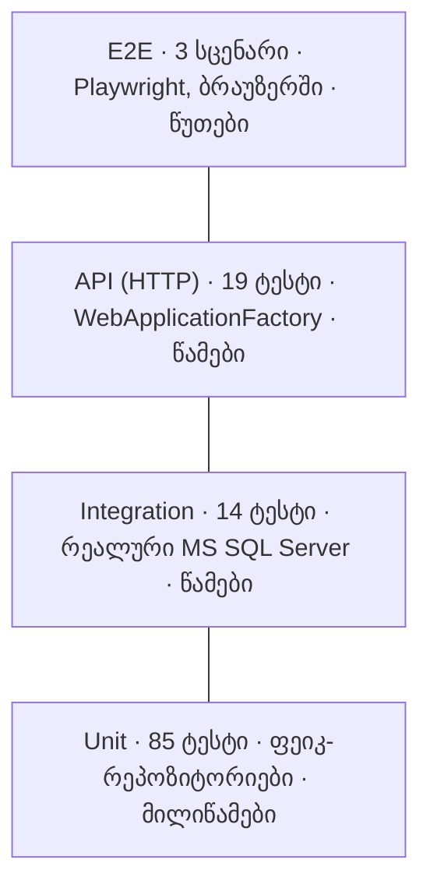

# ტესტირების სტრატეგია (ლექცია 5)

BookSpace-ის ხარისხს ოთხი დონის ავტომატური ტესტი, სტატიკური შემოწმება და Code Review იცავს. ყველაფერი ეშვება GitHub Actions-ში ყოველ push-ზე და Pull Request-ზე (`.github/workflows/ci.yml`).

## ტესტების პირამიდა



| დონე | პროექტი | რაოდენობა | რას ამოწმებს | დამოკიდებულებები | სიჩქარე |
|---|---|---:|---|---|---|
| Unit | `tests/BookSpace.UnitTests` | 85 | ერთ კლასს / ფუნქციას (წესები, ვალიდაცია, სერვისები) | ფეიკები (`InMemory…Repository`, `FakeClock`) | მილიწამები |
| Integration | `tests/BookSpace.IntegrationTests` | 14 | სერვისი + EF Core + **რეალური ბაზა** (unique index, ერთდროული დაჯავშნა, seed) | MS SQL Server 2022 კონტეინერი (ლოკალურად SQLite) | წამები |
| API (HTTP) | `tests/BookSpace.ApiTests` | 19 | მთელი აპლიკაცია HTTP-ით: routing, ავტორიზაცია, CSRF, სტატუს-კოდები, rate limiting, Swagger | TestServer + რეალური ბაზა | წამები |
| End-to-End | `tests/BookSpace.E2ETests` | 3 | მომხმარებლის სრული სცენარი ბრაუზერში (ძებნა → დაჯავშნა → გაუქმება) | გაშვებული აპლიკაცია + Chromium | წუთები |
| დატვირთვა | `load/rooms-load.js` | 2 სცენარი | არაფუნქციური მოთხოვნები NFR-1, NFR-2 | გაშვებული აპლიკაცია + k6 | ~1 წუთი |

ფორმა პირამიდისაა: ბევრი სწრაფი და იაფი unit-ტესტი ძირში, ცოტა ნელი E2E მწვერვალზე. შეცდომის ზუსტ ადგილს unit-ტესტი პოულობს; E2E ადასტურებს, რომ ნაწილები ერთად მუშაობს.

## QA და QC · ვერიფიკაცია და ვალიდაცია

| ცნება | კითხვა | BookSpace-ში |
|---|---|---|
| **QA** (Quality Assurance) — პროცესი, რომელიც შეცდომას თავიდან იცილებს | „სწორად ვაკეთებთ?“ | Definition of Done, Pull Request + Code Review, CI ყოველ ცვლილებაზე, `.editorconfig` + `dotnet format`, TDD |
| **QC** (Quality Control) — მზა პროდუქტის შემოწმება | „სწორი გამოვიდა?“ | unit / integration / API / E2E ტესტები, coverage ანგარიში, დატვირთვის ტესტი |
| **ვერიფიკაცია** — შეესაბამება სპეციფიკაციას | „სწორად ვაშენებთ პროდუქტს?“ | ტესტები Given/When/Then კრიტერიუმებზე და საზღვრებზე (`test-scenarios.md`) |
| **ვალიდაცია** — შეესაბამება მომხმარებლის საჭიროებას | „სწორ პროდუქტს ვაშენებთ?“ | E2E სცენარები სტუდენტის თვალით; Sprint Review-ზე დემო stakeholder-ებთან |

## ტესტების სახეები

- **Black-box** — API და E2E ტესტები იცნობს მხოლოდ შესატანს და შედეგს (HTTP მოთხოვნა → სტატუსი, ღილაკი → გვერდი).
- **White-box** — unit-ტესტები ამოწმებს შიდა ტოტებს (მაგ. `DailyLimitPolicy`-ის ყველა შემთხვევა, `Result`-ის შეცდომის კოდები).
- **ფუნქციონალური** — „რას აკეთებს“: რეგისტრაცია, დაჯავშნა, გაუქმება, როლები.
- **არაფუნქციური** — „როგორ აკეთებს“: სიჩქარე და დატვირთვა (k6), უსაფრთხოება (CSRF, 401/403, rate limiting).
- **რეგრესიული** — CI ყველა ტესტს უშვებს ყოველ push-ზე და PR-ზე, ასე რომ ახალი ცვლილება ძველ ფუნქციას ვერ გატეხავს შეუმჩნევლად.

## კარგი unit-ტესტის თვისებები (FIRST)

| | BookSpace-ში |
|---|---|
| **F**ast | 85 unit-ტესტი 1 წამზე ნაკლებში — ბაზისა და ქსელის გარეშე |
| **I**ndependent | ყოველ ტესტს ახალი ფეიკები და ახალი ბაზა აქვს; რიგითობას მნიშვნელობა არ აქვს |
| **R**epeatable | „ახლა“ ფიქსირებულია (`FakeClock`, `FixedClock` = 2026-11-10 10:30) — შედეგი არ არის დამოკიდებული რეალურ დროზე |
| **S**elf-validating | ყოველი ტესტი `Assert`-ით თავად ამბობს pass / fail |
| **T**imely | `DailyLimitPolicy` TDD-ით, კოდამდე დაიწერა (`tdd-cycle.md`) |

## Flaky ტესტების თავიდან აცილება

- **დრო** — არცერთი ტესტი არ იყენებს `DateTime.Now`-ს; `IClock` ყველგან ჩანაცვლებულია.
- **E2E სელექტორები** — `data-testid` ატრიბუტები (`room-card`, `book-slot`, `upcoming-booking`, `cancel-booking`), არა CSS კლასები.
- **ლოდინი** — Playwright ელოდება ელემენტს (`Expect(...).ToBeVisibleAsync()`), `sleep()`-ის გარეშე.
- **მონაცემები** — ყოველ integration/API ტესტს სუფთა ბაზა აქვს; E2E ქმნის ახალ, უნიკალურ სტუდენტს (`e2e-{guid}@uni.edu.ge`); production ბაზას ტესტი არასდროს ეხება.

## Code Review და CI

| ეტაპი | BookSpace |
|---|---|
| Branch → Pull Request | ცვლილება ცალკე ტოტზე, PR-ით main-ში (`main` დაცულია) |
| CI | `lint` (ფორმატი + code-style analyzers) → `build-and-test` (unit, integration, API + coverage) → `e2e-and-load` (Playwright + k6) |
| Review | Reviewer-ის ჩეკლისტი — `code-review.md`; მაგალითი — PR #17 |
| Merge | მხოლოდ მწვანე CI-ით |

## სტატიკური ანალიზი

| ტიპი | ინსტრუმენტი |
|---|---|
| Formatter | `dotnet format whitespace --verify-no-changes` (`.editorconfig`) |
| Linter / code style | Roslyn analyzers, `EnforceCodeStyleInBuild` — ფრჩხილები, file-scoped namespace, დასახელება (`_camelCase` ველები), არასაჭირო `using` |
| Type checker | C# კომპილატორი + `Nullable` ჩართულია ყველა პროექტში |
| Coverage | coverlet + ReportGenerator — უტესტო ადგილების საპოვნელად, არა მიზნად (`coverage.md`) |

## როგორ გავუშვა

```bash
dotnet test                       # unit + integration + API (E2E გამოტოვებულია)

# E2E: ჯერ აპლიკაცია, მერე ტესტები
dotnet run --project src/BookSpace.Web
pwsh tests/BookSpace.E2ETests/bin/Debug/net8.0/playwright.ps1 install chromium   # ერთხელ
BOOKSPACE_E2E_URL=http://localhost:5180 dotnet test tests/BookSpace.E2ETests

# დატვირთვა (k6 უნდა იყოს დაყენებული: https://k6.io)
k6 run -e BASE_URL=http://localhost:5180 load/rooms-load.js
```
